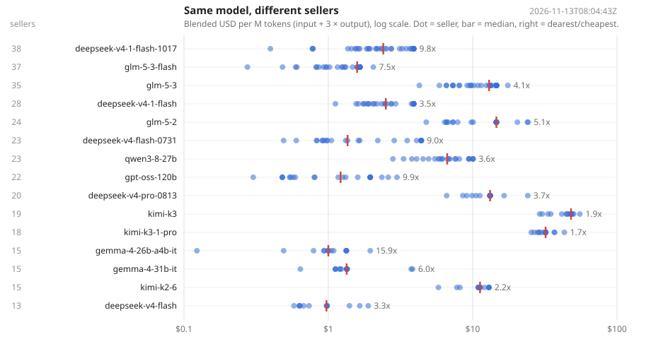

# tokenprice

**The same open-weight model is sold by dozens of providers at prices that differ 2x to 10x. This feed measures that gap every hour, with provenance on every number.**


**[Live table](https://sidscott1410.github.io/tokenprice/)** · **[This week's price moves](prices/MOVES.md)** · **[Feed files](prices/)**



*One dot per seller, red bar at the median, number at right is dearest over cheapest. Regenerated by the Action whenever a price moves.*

## Get the data

No install, pick a format:

| want | file |
|---|---|
| everything, one row per listing | [`prices/latest.csv`](prices/latest.csv) · [`prices/latest.json`](prices/latest.json) |
| per-model dispersion across providers | [`prices/spread.json`](prices/spread.json) |
| price changes, append-only | [`prices/history/YYYY-MM-DD.jsonl`](prices/history/) |
| LiteLLM drop-in (`model_prices_and_context_window` shape) | [`prices/litellm.json`](prices/litellm.json) |
| counts and the top spread, for badges | [`prices/summary.json`](prices/summary.json) |

Raw URL pattern: `https://raw.githubusercontent.com/SidScott1410/tokenprice/main/prices/<file>`.

```python
# LiteLLM users: price OpenRouter calls from the live feed instead of the bundled table
import json, urllib.request, litellm
u = "https://raw.githubusercontent.com/SidScott1410/tokenprice/main/prices/litellm.json"
litellm.register_model(json.load(urllib.request.urlopen(u)))
```

```python
import pandas as pd
df = pd.read_csv("https://raw.githubusercontent.com/SidScott1410/tokenprice/main/prices/latest.csv")
df[df.model == "deepseek-v4-1-flash"].sort_values("blended_per_m")
```

## Python and CLI

```
pip install git+https://github.com/SidScott1410/tokenprice
```

```python
import tokenprice
tokenprice.refresh()                              # pull latest.json (the package ships a snapshot)
tokenprice.get("qwen3-6-35b-a3b")                 # cheapest listing: a Record with provider, source URL, read_at
tokenprice.cheapest("qwen3-6-35b-a3b", n=3)
tokenprice.spread("qwen3-6-35b-a3b")              # {n, min, p10, median, p90, max, ratio, ratio_p90, ratio_p90_p10, median_x, ...}
```

```
tokenprice qwen3-6-35b-a3b              # every seller, cheapest first, with quantization and context
tokenprice qwen3-6-35b-a3b --spread     # dispersion stats
tokenprice --since 2026-11-13           # recorded price changes since a day
tokenprice --models
```

## What makes this different

1. **Provenance is mandatory.** Every record carries the URL it was read from, the read time, and how (`api`, `page`, `manual`). A record without them is refused at construction. There are no hand-entered prices anywhere in the feed.
2. **It measures sellers, not models.** Price pages show one number per model. This feed shows the distribution across everyone selling it, with each provider collapsed to its best tier first so a provider's own priority/flex tiers never masquerade as a market spread.
3. **History is a changelog, not a log.** A line is written only when a price moves or a listing appears or vanishes. `MOVES.md` is regenerated hourly as the human-readable digest.
4. **Robust statistics.** `ratio` (max/min) is one premium outlier away from meaningless; it is kept for transparency. Quote `ratio_p90_p10` (the pack) or `median_x` (typical seller over the floor).

## Conventions

- USD per million tokens. Blended = `input + 3 × output` (a 1:3 mix, the Artificial Analysis convention). It is a ranking rule, not your bill.
- Free tiers (price 0) and OpenRouter's `-1` dynamic-priced listings are dropped: neither is a price.
- Model keys are normalized: provider prefix, date suffix and variant tags stripped, `.` and `_` become `-`. `anthropic/claude-sonnet-4.5` and `claude-sonnet-4-5-20250929` are one key; the raw id is kept in `model_raw`.
- Spread needs two or more distinct upstream providers. The router's own listing (`provider: openrouter`) is kept in the feed and excluded from spread.

## Method and limits

- Source today: OpenRouter's public `/api/v1/models` (one router price per model) and `/api/v1/models/{id}/endpoints` (per-provider prices, quantization, context). One request per model, paced at 150 ms. About 450 models, 80 providers, 1,900 listings per run.
- Not covered: first-party list prices outside the router (OpenAI, Anthropic, Google direct). A `page` scraper for those is the next addition; it will enable a router-markup metric.
- A listing's price is what the provider quotes, not what you get after rate limits, uptime, or quality drift. Same model id does not guarantee same weights or same serving quality; quantization is recorded where the provider declares it.
- Run cadence is hourly. Sub-hour moves are missed.

## Citing

See [CITATION.cff](CITATION.cff). State the `read_at` of the snapshot you used; prices move hourly.

## Contributing

A scraper is a module in `tokenprice/scrapers/` with `scrape() -> list[Record]`, called from `cli._update`. First-party pricing pages are the most wanted. Open an issue with the URL before writing it, so provenance rules are agreed up front.

## Related

- [agent-cost](https://github.com/SidScott1410/agent-cost): prices an agent run step by step; uses this feed when installed.
- [reckon](https://github.com/reckonresearch/reckon): measured served-token cost on real silicon, the supply side of the same question.
- [awesome-ai-compute-economics](https://github.com/SidScott1410/awesome-ai-compute-economics): the reading list.

## License

Code: Apache-2.0. Feed data in `prices/`: [CC BY 4.0](https://creativecommons.org/licenses/by/4.0/); attribute "tokenprice (Sidney Scott)" with the snapshot date.
